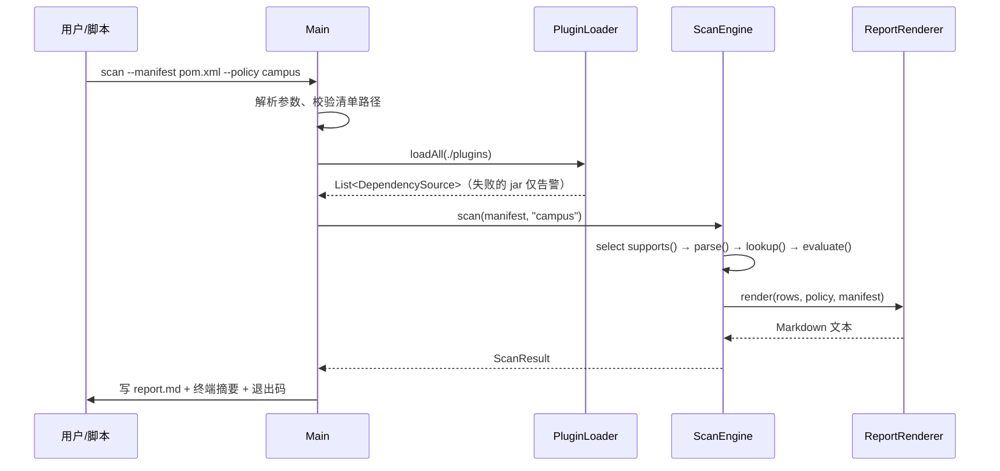

<!--
本文件是 docs/DESIGN.docx 中「CLI 与退出码」一章的 Markdown 草稿，由 C 起草。
章号由主笔统一；合并进 DESIGN.docx 后删除本文件。
TODO(design): 合并进 DESIGN.docx 后删除本文件。
-->

## CLI 与退出码

CLI 是 LicenseLens 的唯一入口：把命令行参数变成一次扫描调用，再把结果翻译成三样东西——报告文件、终端摘要、退出码。本节说明它的职责边界、参数与退出码约定、一次完整调用，以及扩展（插件）在 CLI 侧如何被加载。

### 定位与职责边界

| 归属 | 负责内容 | 代码位置 |
| --- | --- | --- |
| CLI | 参数解析、插件目录加载、调用扫描、写报告文件、终端摘要、退出码映射 | `licenselens-cli/`，入口类 `edu.course.licenselens.cli.Main` |
| core | 选择解析器、匹配许可证快照、策略判定、渲染 Markdown 报告 | `licenselens-core/` |
| spi | `DependencySource` / `Policy` / `Decision` 等公开契约 | `licenselens-spi/` |

依赖方向固定为 `cli → core → spi`，CLI 不被任何模块反向依赖。清单解析和许可证判断都不在 CLI 里做：CLI 只决定"扫哪个文件、用哪个策略、插件从哪加载"，其余交给 core。

内置 Maven 解析器由 CLI 在组装阶段注入（`new MavenManifestParser()`），外部解析器从插件目录加载，两者都按 `DependencySource` 对待，后续调度一视同仁。

### 命令与参数

```text
licenselens scan --manifest <文件> [--policy campus|permissive-only]
                 [--plugins <目录>] [--out <路径>]
```

| 参数 | 必填 | 默认值 | 说明 |
| --- | --- | --- | --- |
| `--manifest <路径>` | 是 | — | 待扫描的依赖清单文件 |
| `--policy <策略>` | 否 | `campus` | 策略 id：`campus` 或 `permissive-only` |
| `--plugins <目录>` | 否 | `./plugins` | 插件 jar 目录；目录不存在时告警并跳过，不中断扫描 |
| `--out <路径>` | 否 | `./report.md` | 报告输出路径；父目录不存在时自动创建 |
| `-h` / `--help` | 否 | — | 打印用法并退出 0 |

两种策略的差异落在 core：`campus` 对弱 copyleft 只告警，`permissive-only` 把弱 copyleft 和未知许可证都判为阻断。CLI 只做"策略 id 是否存在"的校验，不参与判定逻辑。

参数解析是防御式的：选项缺值（如 `scan --manifest` 后没有内容）、未知参数、未知子命令都会转成参数错误提示，不抛出未捕获异常。`--help` 出现在任意位置都优先展示用法。

### 退出码

退出码是 CLI 与外部脚本、CI 的唯一约定，取值与触发位置如下：

| 退出码 | 含义 | 触发位置 |
| --- | --- | --- |
| `0` | 正常，无阻断依赖 | 扫描完成且 `blockedCount == 0`；`--help` 也返回 0 |
| `1` | 存在阻断依赖 | 扫描完成且 `blockedCount > 0` |
| `2` | 清单文件不存在 | CLI 预检路径不存在；或解析器抛 `SourceException.FILE_NOT_FOUND` |
| `3` | 清单语法错误 | 解析器抛 `SourceException.PARSE_ERROR`，stderr 提示带行号 |
| `4` | 无可用解析器 | 所有 `DependencySource.supports()` 都返回 false |

映射集中在 `Main.run(String[])`：它返回 `ExitCode` 枚举，`main` 只负责 `System.exit(code.code)`。测试直接调用 `run` 断言退出码，不触发进程退出。

```java
static ExitCode run(String[] args) { ... }   // 纯函数式返回，便于测试
public static void main(String[] args) {
    System.exit(run(args).code);
}
```

错误信息统一写 stderr，正常结果与报告写 stdout / 文件：

| 场景 | stderr 提示 |
| --- | --- |
| 清单不存在 | `清单文件不存在: <路径>` |
| 语法错误 | `清单第 <N> 行附近格式错误: <消息>`（无行号时省略行号） |
| 无解析器 | `未找到可解析该文件的插件，请检查 plugins/ 目录` |
| 参数错误 | `参数错误: <原因>`，并提示运行 `--help` |
| 插件目录缺失 | `WARN: 插件目录不存在，跳过插件加载: <目录>` |
| 报告写入失败 | `报告写入失败: <路径> (<原因>)`，随后告警"退出码只反映审计结果" |

参数错误目前复用退出码 `2`：契约退出码表没有"用法错误"这一档，新增属于契约变更，需全组确认后再改。这是已知缺口，不是设计意图。

### 一次完整调用



终端摘要是一行，便于 CI 日志里快速定位：

```text
策略: campus | 依赖数: 4 | 阻断: 1 | 未知: 0
```

失败分支走同一入口：`ScanEngine` 抛 `SourceException`，`Main` 按 `code()` 映射退出码并在 stderr 说明，不打印堆栈。

### 与 core 的接口

CLI 只依赖 `ScanResult` 这一个结果类型，不感知报告内部结构：

| 字段 | 类型 | 用途 |
| --- | --- | --- |
| `exitCode` | `int` | 扫描结果对应的退出码（0 或 1） |
| `totalCount` | `int` | 依赖总数，用于终端摘要与报告摘要 |
| `blockedCount` | `int` | 阻断数量，决定退出码 |
| `unknownCount` | `int` | 未命中许可证快照的数量 |
| `reportContent` | `String` | 完整 Markdown 报告，由 CLI 落盘 |

报告内容由 `ReportRenderer` 生成，CLI 不拼接报告文本，只负责写入与摘要。

### 扩展（插件）的加载

1. 列出 `--plugins` 目录下的全部 `*.jar`（目录不存在则告警跳过）；
2. 每个 jar 建一个独立的 `URLClassLoader`，用 `ServiceLoader.load(DependencySource.class, loader)` 发现实现；
3. 读取 jar 内 `META-INF/services/edu.course.licenselens.spi.DependencySource` 声明的类；
4. 单个 jar 加载失败只告警并跳过，继续扫描，退出码不变。

独立类加载器的理由是隔离：插件可能自带与宿主不同版本的第三方库，共享 classpath 会互相污染。插件之间、插件与内置 Maven 解析器之间，只通过 `DependencySource` 契约协作——选择哪个解析器由 core 按 `id()` 字典序与 `supports()` 决定，CLI 不硬编码任何插件名。

已知限制：当前实现用 try-with-resources 关闭 `URLClassLoader` 后才返回已发现的实例。已加载的类仍可用，但插件中延迟加载的类可能失败；计划改为进程结束再释放。`samples/demo-npm`、`samples/demo-go` 的插件接入测试（T7/T9）依赖独立扩展落地后补充。

### 测试覆盖

`licenselens-cli/src/test/java/edu/course/licenselens/cli/MainTest.java` 直接调用 `Main.run`，覆盖 10 个用例：

| 用例 | 断言 |
| --- | --- |
| T1 正常扫描 | 退出码 `1`，报告文件已写出 |
| T2 `permissive-only` | 退出码 `1` |
| T3 空清单 | 退出码 `0`，报告仍写出 |
| T5 清单不存在 | 退出码 `2` |
| T6 语法错误 | 退出码 `3` |
| T8 插件目录为空 | 退出码 `4` |
| 选项缺值 | 退出码 `2`，不抛异常 |
| 未知参数 | 退出码 `2` |
| 未知策略 | 退出码 `2`，扫描前被拦下 |
| 插件目录不存在 | 告警后照常扫描，退出码 `1` |

运行方式：

```bash
mvn -B test -pl licenselens-cli
```

### 已知限制

1. 参数错误复用退出码 `2`，"用法错误"尚无独立退出码（待契约变更）。
2. 报告写入失败只告警，退出码仍反映审计结果；不会把"报告没写出来"与"审计通过"混为一谈，但调用方需要读 stderr。
3. 只实现 `scan` 一个子命令；`--plugins` 指向的目录不存在时仅告警。
4. 插件类加载器的生命周期问题见上一节，属计划修复项。
